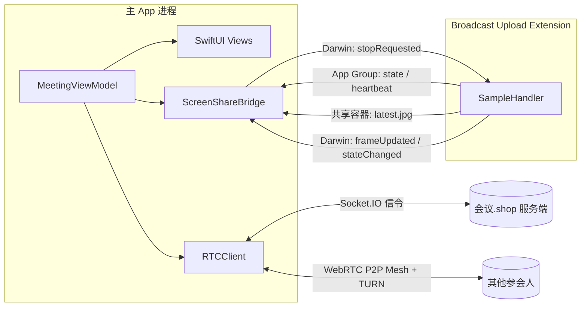

# MeetingKit · iOS 会议 + 系统级屏幕共享

对标钉钉 / 腾讯会议 / Webex 的移动端会议界面：**沉浸式视频画布 + 毛玻璃悬浮控制栏 + ReplayKit 系统级屏幕共享**。
纯 SwiftUI，最低 **iOS 14.0**（iPhone 6s 及以后全部机型），iOS 26 在 Xcode 26 下自动切换为原生 Liquid Glass。

> 本项目是**已接入真实服务端**的完整客户端：REST 走 `https://xn--6oqu09l.shop/api`（「会议.shop」），
> 信令走同域 Socket.IO，音视频是原生 WebRTC P2P Mesh（`stasel/WebRTC`），屏幕共享走 ReplayKit 广播扩展 + 自定义视频源。
> `MockRTCClient` 仅保留给 UI 预览与单元调试，正式入口固定为 `RealRTCClient`。

---

## 0. 这次交付包含什么

| 产物 | 位置 | 用途 |
|---|---|---|
| 完整源码工程 | `MeetingKit/` | XcodeGen 描述的双 Target 工程（主 App + 广播扩展） |
| 服务端 | `../tianqiong/server` | Node.js + Socket.IO + SQLite，与 Web 端同一套 |
| 界面预览（静态） | `docs/ui-preview.html` | 三屏设计稿，浏览器打开即可看 |
| **网页测试包（可安装）** | `webdemo/` | 可交互的会议界面，Safari「添加到主屏幕」即可装到 iPhone |
| 出包脚本 | `scripts/build-ipa.sh` 等 | macOS 本地一键出 IPA |
| 云端出包 | `.github/workflows/ios-build.yml` | 没有 Mac 也能在 GitHub Actions 上出 IPA |
| 安装手册 | `docs/build-and-install.md` | 三条安装路径的完整步骤与排错 |
| 共享链路设计 | `docs/screen-sharing.md` | 跨进程时序、失败模式、排查表 |

> **关于「测试安装包（.ipa）」**：iOS 二进制必须用 Apple 的 iOS SDK 编译、并用 `codesign` 签名，这两样只在 macOS + Xcode 上可用。本项目的开发环境是 Linux，**无法直接产出可安装的 .ipa**——这不是工程配置问题，是平台限制。因此提供了三条可落地的替代路径（见第 9 节）：GitHub Actions 云端出包、本地 Mac 出包、以及**今天就能装到手机上的网页测试包**。

---

## 1. 已实现

| 模块 | 能力 |
|---|---|
| 会议主界面 | 演讲者模式（大画面 + 顶部缩略图条）、宫格模式（≤9 宫格分页）、点击画布隐藏/显示控件 |
| 屏幕共享 | ReplayKit Broadcast Upload Extension，系统级共享（可共享其他 App / 桌面）；共享中顶部常驻红色警示条、底栏按钮变红、主画面切换为共享内容 |
| 跨进程 | App Group + Darwin 通知双向通信；状态、画面帧、心跳、停止指令四条通道 |
| 本机控制 | 麦克风 / 摄像头 / 前后摄切换 / 举手 / 录制 / 虚拟背景 / 美颜 / 降噪 |
| 参会人 | 搜索、主持人分组、角色角标、静音/举手/弱网状态、全部静音、锁定、移出、邀请（写系统剪贴板） |
| 聊天 | 气泡列表、系统消息、未读角标、键盘避让、自动滚底、稳定头像配色 |
| 共享选择 | 共享来源卡片、系统广播选择器唤起、三步引导、共享计时、停止共享 |
| 会议生命周期 | 时长计时、连接状态（连接中/重连中/断开）、结束会议 → 离会遮罩 → 重新入会 |
| 兼容性 | iOS 14 → iOS 26；刘海 / 灵动岛 / 底部横条；iPhone SE ~ Pro Max；降低透明度 / 增强对比度 |

---

## 2. 一分钟跑起来

### 2.1 前置

- **Xcode 15 及以上**（推荐 16；要启用 iOS 26 原生玻璃需 **Xcode 26 / Swift 6.2**）
- **iOS 14.0+ 真机**（模拟器无法测试屏幕共享，广播扩展只在真机出现）
- [XcodeGen](https://github.com/yonaskolb/XcodeGen)：`brew install xcodegen`

### 2.2 生成工程

```bash
cd MeetingKit
xcodegen generate          # 读取 project.yml，产出 MeetingKit.xcodeproj
open MeetingKit.xcodeproj
```

然后在 Xcode 里完成签名：

1. `MeetingKit` target → Team 选自己的账号，Bundle Identifier 改成自己的（如 `com.yourcompany.meeting`）
2. `MeetingBroadcast` target → 同样选 Team，Bundle Identifier 必须是 **主 App Bundle ID + `.Broadcast`**
3. 两个 target 都要有 **App Groups** 能力，且组名完全一致（默认 `group.com.example.meetingkit`）

### 2.3 手动建工程（不想装 XcodeGen）

1. 新建 iOS App（SwiftUI，最低 iOS 14），命名 `MeetingKit`
2. 把 `MeetingKit/`（除两个配置文件）拖进主 target；`Shared/` 同时勾选两个 target
3. 新建 Broadcast Upload Extension target，命名 `MeetingBroadcast`，用 `BroadcastExtension/SampleHandler.swift` 替换模板，`Shared/` 也加入该 target
4. 用仓库里的两个 `Info.plist` 覆盖模板
5. 两个 target 都加 App Groups，组名统一
6. 主 App 的 Background Modes 勾 **Audio, AirPlay, and Picture in Picture**（即 plist 里的 `audio`）

### 2.4 验证共享链路

1. 真机运行 → 点底栏「共享屏幕」
2. 面板里点「开始共享屏幕」→ 系统弹出广播选择器
3. 选中 **MeetingKit 屏幕共享** → 点「开始直播」
4. 顶部出现红色警示条，主画面变成你正在共享的内容（约 0.3s 内出第一帧）
5. 点警示条右侧「停止共享」→ 扩展自行结束，红条消失

---

## 3. 必须改的 4 个标识

| 标识 | 位置 | 默认值 |
|---|---|---|
| App Group | `Shared/AppGroupConfig.swift` + 两个 `.entitlements` | `group.com.example.meetingkit` |
| 主 App Bundle ID | `project.yml` + `AppGroupConfig.bundleIdentifier` | `com.example.MeetingKit` |
| 扩展 Bundle ID | `project.yml` + `broadcastExtensionBundleIdentifier` | `com.example.MeetingKit.Broadcast` |
| 展示名 | 两个 `Info.plist` | `天穹会议` / `天穹会议 屏幕共享` |
| 服务端地址 | 主 App `Info.plist` 的 `TQServerOrigin` | `https://xn--6oqu09l.shop` |

> 扩展 Bundle ID **必须**以主 App 为前缀，否则系统不会把它列进「屏幕录制」列表；三处 App Group 必须逐字一致，错一个字符就是"扩展能启动但 App 收不到状态"。
> 服务端地址只能写 **punycode**（`xn--6oqu09l.shop`），中文域名直接塞进 `URL(string:)` 会得到 nil；
> 需要切测试环境时改 `TQServerOrigin` 即可，源码里没有第二处硬编码。

---

## 4. 工程结构

```
MeetingKit/
├── project.yml                     # XcodeGen 工程描述（双 Target + App Group + 内嵌扩展）
├── Shared/                         # 两个 Target 各编译一份，跨进程契约的唯一来源
│   ├── AppGroupConfig.swift
│   ├── ScreenShareSignal.swift     # 状态、心跳、Darwin 通知
│   └── SharedFrameStore.swift      # 最新画面帧（JPEG）
├── BroadcastExtension/
│   ├── SampleHandler.swift         # 采帧 → 缩放 → JPEG → 落盘 + 心跳
│   ├── Info.plist
│   └── MeetingBroadcast.entitlements
├── MeetingKit/
│   ├── App/MeetingKitApp.swift
│   ├── Core/                       # RealRTCClient / PeerSession / TianqiongSignaling / APIClient / ScreenShareBridge
│   ├── Models/
│   ├── Compat/CompatKit.swift      # iOS 14 兼容层：animationCompat、SymbolCompat、确认弹窗
│   ├── Theme/
│   │   ├── Theme.swift             # 设计令牌
│   │   ├── LiquidGlass.swift       # ★ Liquid Glass 2.0 组件（原生 + 五层降级）
│   │   └── GlassSurface.swift      # 旧 API 的薄封装（20+ 调用点零改动）
│   ├── ViewModels/MeetingViewModel.swift
│   └── Views/                      # 主界面、画布、顶栏、底栏、小窗、4 个面板、通用组件
├── scripts/                        # 出包 / 工程体检（Linux 也能跑体检）
├── .github/workflows/ios-build.yml # 云端出 unsigned IPA
├── webdemo/                        # 可安装到主屏的网页测试包（PWA）
└── docs/
    ├── screen-sharing.md
    ├── build-and-install.md
    └── ui-preview.html
```

---

## 5. Liquid Glass 2.0

> Apple 官方只叫 **Liquid Glass**（iOS 26 的 `glassEffect` / `GlassEffectContainer`），没有 "2.0" 这个版本号。这里说的 2.0 是本项目在该 API 之上补的一层组件能力：**合并、形变、交互、着色、降级**。

### 5.1 组件 API

```swift
// 三档语义
enum LiquidGlassVariant { case regular, clear, tinted(Color) }
enum LiquidGlassCornerStyle { case continuous(CGFloat), capsule, circle }

// 任意视图加玻璃
Text("8").liquidGlass(.clear, cornerStyle: .capsule, isInteractive: true)

// 相邻玻璃融合（iOS 26 真融合，低版本等价布局）
LiquidGlassContainer(spacing: 18) {
    ForEach(controls) { $0.liquidGlass(.clear, cornerStyle: .circle) }
}

// 按钮样式：按压 0.96 + 高光扫过
Button("开始共享") { … }.buttonStyle(.liquidGlassProminent)

// 形变锚点（底栏按钮 → 面板）
someView.liquidGlassID("share", in: glassNamespace)

// 全局降级开关（低端机 / 录屏降负载）
LiquidGlassSettings.isEnabled = false   // 全部退化为实色 + 描边
```

### 5.2 两条渲染路径

| 维度 | iOS 26（`#if compiler(>=6.2)` + `#available`） | iOS 14~25（手写五层） |
|---|---|---|
| 材质 | `content.glassEffect(glass, in: shape)` | `UIVisualEffectView` 模糊 + 底色 + 镜面高光 + 1px 渐变描边 + 投影 |
| 交互 | `Glass.interactive()` | 0.97 缩放 + 高光位移 |
| 相邻融合 | `GlassEffectContainer` 真实吸附 | 布局一致，无融合 |
| 形变 | `glassEffectID` | 空实现 |
| 无障碍 | 系统自动处理 | `accessibilityReduceTransparency` → 实色；`increaseContrast` → 加强描边 |

关键点：`#if compiler(>=6.2)` 是**编译期**开关。用 Xcode 15/16 构建时整段被剔除，走手写玻璃，**不会编译失败**；用 Xcode 26 构建才会启用原生玻璃。所以同一份代码在两种工具链下都能出包。

### 5.3 为什么不用 `.ultraThinMaterial`
`Material` 是 iOS 15+，与 iOS 14 baseline 冲突；且纯 Material 压在亮画面上会发灰、文字对比度不够。降级路径统一用 `UIBlurEffect` + 黑色 0.28 叠加 + 渐变描边，视觉更接近原生玻璃，也更好控制可读性。

---

## 6. 架构与数据流



状态机：

```
idle ──开始直播──▶ active ──暂停──▶ paused ──恢复──▶ active
                      │                                  │
                      ├──────── 用户停止 / 停止指令 ──────┤
                      └──────── 进程被杀（心跳超时）──────┘
                                    ▼
                                  idle（清帧、清状态）
```

完整时序、失败模式、排查表见 [`docs/screen-sharing.md`](docs/screen-sharing.md)。

---

## 7. 屏幕共享链路（8 步）

1. 点「开始共享屏幕」→ `BroadcastPickerPresenter.present()` 唤起系统广播选择器
2. 选中扩展并点「开始直播」→ 系统启动 `MeetingBroadcast` 进程
3. `broadcastStarted` 写 `state = .active` + `startedAt` + 首次心跳，post `stateChanged`
4. 主 App `ScreenShareBridge` 收到 → `isScreenSharing = true` → 红条 + 底栏红色 + 画布切共享态
5. 每帧：节流 24fps → 短边缩到 1080 → JPEG(0.78) → 写共享容器 → post `frameUpdated`
6. 主 App 按 10fps 上限读取 + 解码（`readIfNewer` 去重）→ `sharedFrame` 更新
7. 扩展每 2 秒刷心跳；主 App 每 4 秒 `validateLiveness()`，12 秒无心跳判死并清脏状态
8. 停止：主 App post `stopRequested` → 扩展先清状态再 `finishBroadcastWithError` → UI 复位

> **JPEG 通道同时是推流源**：`ScreenFramePusher` 每 0.4s 读取最新帧、解码成 `RTCCVPixelBuffer`，
> 以 `CVPixelBuffer` 自定义视频源喂给 WebRTC（按宽高比自适应 1280×720 / 720×1280），对端通过 `screen:state` 区分共享画面。
> 因此不需要二次重协商，也不会抢占摄像头轨道。

---

## 8. 服务端协议与真实 RTC

音视频链路由三部分组成，全部已在真机路径上接线：

| 层 | 实现 | 说明 |
|---|---|---|
| REST | `Core/APIClient.swift` | 登录、注册、会议详情、`/rtc/ice`（TURN 临时凭证） |
| 信令 | `Core/TianqiongSignaling.swift` | `socket.io-client-swift`，事件名与 Web 端逐字一致 |
| 媒体 | `Core/RealRTCClient.swift` + `Core/PeerSession.swift` | `stasel/WebRTC`，一对多 P2P Mesh |

入会时序：

1. `room:join`（`emitWithAck`）→ 返回 `self / peers / messages / screenPeerId / meeting / locked / resumed`
2. 对每个 peer 建 `RTCPeerConnection`，本机为每个 peer 添加同一路音视频轨道
3. `rtc:signal` 交换 SDP / ICE；**Perfect Negotiation**：`peerId` 字典序小的一方为 polite，glare 时由 polite 方 `rollback` 后应答
4. 断线由 Socket.IO 自动重连，重连后重新 `room:join` 拿快照、全量重建 peer、逐条 `restartIce`
5. 服务端下发 `session:replaced` / `session:revoked` 时立即终态退出，不再重试

屏幕共享沿用 Web 端的 `replaceTrack` 模型：共享轨道替换摄像头 sender，`screen:state` 通知对端切换显示。

> 不再需要"新建 TRTCRTCClient"：`RTCClient` 协议已由 `RealRTCClient` 实现，`MockRTCClient` 只用于 SwiftUI 预览。

## 9. 打包与安装（三条路径）

详细步骤见 [`docs/build-and-install.md`](docs/build-and-install.md)。

| | ① GitHub Actions | ② 本地 Mac | ③ 网页测试包 |
|---|---|---|---|
| 需要 | GitHub 账号 + 任意电脑 | macOS + Xcode | 任意静态托管 |
| 出包 | 5~10 分钟 | 1~2 分钟 | 无需构建 |
| 产物 | 未签名 `.ipa` | 签名/未签名 `.ipa` | 可安装 PWA |
| 生效 | 免费账号 7 天 / 付费 1 年 | 同左 | 永久 |
| 适合 | 没有 Mac | 日常开发 | 今天就要看效果 |

**① 云端出包**：把仓库推到 GitHub → Actions → `iOS Build` → Run workflow → 下载 `MeetingKit-unsigned-ipa` → 用 Sideloadly / AltStore 用自己的 Apple ID 重签安装。

**② 本地 Mac**：

```bash
brew install xcodegen
./scripts/build-ipa.sh --team ABCDE12345   # 有开发者账号
./scripts/build-ipa.sh                      # 没有账号，出未签名包
```

**③ 网页测试包（现在就能装）**：

```bash
cd webdemo && python3 -m http.server 8080
# iPhone Safari 打开 http://<你的电脑IP>:8080
# 分享 → 添加到主屏幕
```

网页测试包实现了真实的界面与交互（布局切换、麦克风/摄像头状态、共享全流程、三个面板、聊天发送、控件显隐），**不采集音视频、不申请权限**，仅用于验收视觉与交互。

### 为什么 Linux / Windows 不能直接出 IPA
iOS 应用必须链接 Apple 的 iOS SDK，并用 `codesign` 做代码签名，二者都只在 macOS 上可用（且受 Apple 许可约束）。交叉编译 + 自签不是合规路径，也无法安装到未越狱设备。所以本项目把"出包"这件事交给 macOS 环境（本地或 GitHub Actions），源码本身与平台无关。

---

## 10. 兼容性

| 项 | 覆盖 |
|---|---|
| 系统 | iOS 14.0 → iOS 26（同一份代码） |
| 机型 | iPhone 6s 起；iPhone SE ~ Pro Max；iPad（`TARGETED_DEVICE_FAMILY 1,2`） |
| 安全区 | 刘海、灵动岛、底部横条；横竖屏切换 |
| 无障碍 | 降低透明度、增强对比度、减少动态效果（`LiquidGlass` 与动效均读取环境值） |
| 工具链 | Xcode 15/16（自绘玻璃）、Xcode 26（原生 Liquid Glass） |
| 深色/浅色 | 会议界面强制深色；玻璃组件本身两套配色，不写死 |

**iOS 14 上被替换掉的 API**（全部有等价实现）：`Material`→`UIVisualEffectView`、`safeAreaInset`→VStack、`@FocusState`→键盘通知、`confirmationDialog`→自绘 `GlassConfirmDialog`、`.animation(_:value:)`→`animationCompat`、`submitLabel/onSubmit`→`onCommit`、SF Symbols 新名称→`SymbolCompat` 候选表。

---

## 11. 已知限制

| 项 | 说明 |
|---|---|
| 共享画面清晰度 | 采集端短边压到 1080（等价 1080p）、JPEG 0.78；再往上内存与落盘先成为瓶颈 |
| 跨网段连通 | 依赖服务端 `/api/rtc/ice` 下发的 TURN；TURN 不可达时只能同网段直连 |
| 扩展内存上限 | 约 50MB。CIContext 复用 + 单帧在途 + autoreleasepool；接 SDK 后需重估 |
| `voip` 未启用 | 没有 PushKit 实现就声明会被审核问询，接入后再加到 `UIBackgroundModes` |
| 停止共享的兜底延迟 | 扩展被强杀时，最长约 12s + 4s 轮询才复位 |
| iOS 26 原生玻璃 | 需要 Xcode 26 构建；CI 默认 `macos-15`（Xcode 16）产物走自绘玻璃 |
| 广播选择器 | `RPSystemBroadcastPickerView` 内部按钮通过遍历 `subviews` 触发，iOS 大版本需回归 |
| 未签名 IPA | 需要 Sideloadly/AltStore 重签；免费 Apple ID 7 天有效 |

### 真机验证清单

- [ ] iOS 14 真机：底栏 6 键、参会人/聊天面板、键盘弹起后仍能关闭面板
- [ ] iOS 17/18：玻璃在亮画面/暗画面下的可读性
- [ ] iOS 26 + Xcode 26：原生玻璃是否生效（`glassEffect` 分支）
- [ ] 静止画面共享 5 分钟，不被误判为"已中断"
- [ ] 共享中杀 App → 重开恢复正确；杀扩展 → 12s 内红条消失
- [ ] 灵动态机型：红条覆盖到屏幕最顶部，无黑边
- [ ] iPhone SE：面板可滚完 8 人；小窗不遮挡顶栏按钮
- [ ] 结束会议 → 重新入会：时长归零、麦克风状态保持、共享状态不残留
- [ ] 真机 4G 与 Wi-Fi 互拨：能拿到 TURN 候选并连通（`/api/rtc/ice` 返回 urls）
- [ ] 飞行模式 10 秒再恢复：自动重连回会，花名册与聊天记录完整
- [ ] 主持人锁定会议后杀 App 重进：老成员可回、新成员被拒（`LOCKED`）

---

## 12. FAQ

**Q：系统「屏幕录制」列表里没有我的扩展？**
扩展 Bundle ID 不是主 App 的子前缀，或扩展没被 `embed` 进 PlugIns。检查 `project.yml` 的 `dependencies: embed: true`。

**Q：扩展起来了，但 App 没反应？**
App Group 三处字符串不一致，或 entitlements 未生效（签名后 Xcode 会报 "Provisioning profile doesn't support the App Groups capability"）。

**Q：共享预览黑屏？**
① 模拟器不支持；② 低电量模式可能限制扩展；③ `SharedFrameStore` 写入失败（容器路径为空）。

**Q：为什么不用 `.sheet` + `.presentationDetents`？**
`presentationDetents` 是 iOS 16+，`safeAreaInset` 是 15+，本项目要兼容 iOS 14；系统 sheet 的玻璃也无法与顶栏/底栏统一材质。自绘 `GlassSheet` 在各版本行为一致。

**Q：能共享单个 App 吗？**
ReplayKit 全量广播做不到。iOS 17+ 的 `ScreenCaptureKit` 支持按窗口采集，但需要另一套管线，本项目未包含。

---

## 13. 开发辅助

```bash
bash scripts/verify-project.sh   # Linux/Windows 也能跑的工程体检（35 项）
                                 # 文件完整性、plist/JSON/YAML、App Group 一致性、
                                 # swiftc -parse、脚本与 CI 配置
```

## 最近变更（2026-11-05）

- 入会默认只开麦克风：`JoinInfo.cameraOn` 默认 `false`，预入会页仍可一键开启。
- 新增 `scripts/gh-build.sh`：没有 Mac 也能用 GitHub Actions 出未签名 IPA（自动建私有仓库 → 触发 → 下载）。
- 出包说明见仓库根目录的 [`BUILD-IPA.md`](BUILD-IPA.md)。
